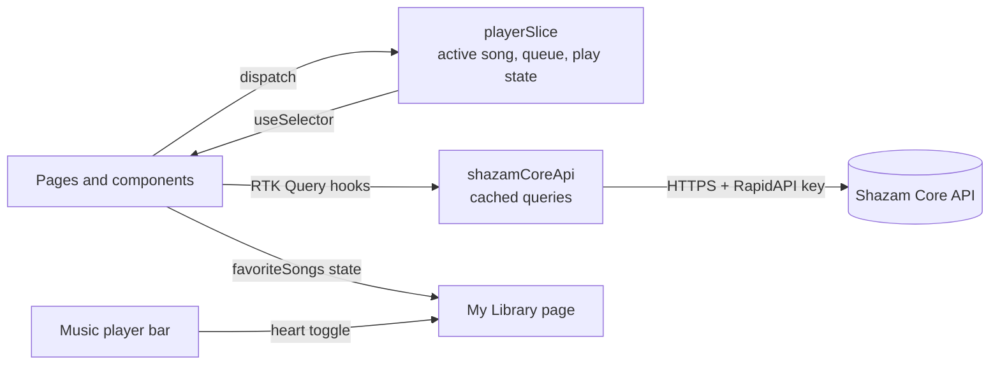

# Ikfram Music App

A Spotify-style music web app built with React, Redux Toolkit and the Shazam Core API. Browse charts by genre, search songs and artists, read lyrics, play previews and save your favourite tracks to a personal library.

[](https://github.com/DanielB-02/ikfram-music-app/actions/workflows/ci.yml)

**Live demo:** [TODO: live demo link]

[TODO: screenshot]
<!-- Suggested capture: the Discover page with a genre selected, the Top Charts / Top Artists panel on the right and the player bar at the bottom showing a red (favourited) heart. A short GIF of hearting a song and opening My Library works even better. Save it as docs/screenshot.png and replace the line above with:  -->

## What it does and why

The app lets you explore what's popular worldwide: pick a genre, see the top charts and top artists, open a song to read its lyrics and find related tracks, and play 30-second previews in a persistent player bar. I built it to practise building a real-world React front end: client-side routing, global state with Redux Toolkit, data fetching and caching with RTK Query, and a responsive Tailwind UI.

The base UI follows a tutorial project ([TODO: confirm and link the tutorial, e.g. JavaScript Mastery's "Lyriks" music player]). On top of that I designed and built the **favourites / My Library** feature myself (see below).

## Key features

- **Discover by genre:** world charts filtered by genre (Pop, Hip-Hop, Dance, …)
- **Top Charts and Top Artists:** pages plus a side panel with a swipeable artist carousel
- **Search:** songs and artists by keyword
- **Song and artist details:** lyrics, related songs, artist top tracks
- **Music player:** play/pause, next/previous, shuffle, repeat, seek bar and volume
- **Favourites / My Library** *(my addition)*:
  - heart a song from the player bar to add it to My Library
  - click the heart again to unfavourite
  - no duplicate entries
  - animated add/remove transitions with Framer Motion
- **Responsive layout:** collapsible sidebar on mobile

## Tech stack

| Area | Tools |
|---|---|
| UI | React 18, Tailwind CSS, Framer Motion, Swiper, React Icons |
| State and data | Redux Toolkit, RTK Query |
| Routing | React Router |
| Build | Vite |
| Quality | ESLint (Airbnb config), Vitest, Testing Library, GitHub Actions |
| API | [Shazam Core](https://rapidapi.com/tipsters/api/shazam-core) via RapidAPI |

## How it works



- **`src/redux/services/shazamCore.js`**: one RTK Query API slice that defines every endpoint (charts, genre charts, search, song/artist details, related songs). Responses are cached and shared between components.
- **`src/redux/features/playerSlice.js`**: global player state. It normalises the different response shapes (plain lists, search `hits`, artist `tracks`) into a single queue so next/previous work everywhere.
- **Favourites** live in React state in `App.jsx` and are passed to the player (heart toggle) and to the My Library page.
- **Error and loading states** are handled per page with shared `Loader` and `Error` components.

## Getting started

**Prerequisites:** Node.js 22+ and a free RapidAPI key with access to the [Shazam Core API](https://rapidapi.com/tipsters/api/shazam-core).

```bash
git clone https://github.com/DanielB-02/ikfram-music-app.git
cd ikfram-music-app
npm install

cp .env.example .env        # then add your RapidAPI key to .env
npm run dev                 # http://localhost:5173
```

| Variable | Description |
|---|---|
| `VITE_SHAZAM_CORE_RAPID_API_KEY` | Your RapidAPI key for Shazam Core |

> **Note:** like every `VITE_*` variable, the key is embedded in the client-side bundle at build time. For a public deployment, use a key with a low quota or route requests through a small server-side proxy (see next steps).

Other scripts:

```bash
npm run build     # production build in dist/
npm run preview   # serve the production build locally
npm run lint      # ESLint
```

## Tests

```bash
npm test
```

Vitest covers the core logic:

- `playerSlice.test.js` checks queue handling for every API response shape, next/previous navigation and play/pause.
- `Controls.test.jsx` checks the favourites heart: add, unfavourite, and no duplicates across repeated clicks.

GitHub Actions runs lint, tests and a production build on every push and pull request.

## What I learned / next steps

- **Learned:** structuring global state with Redux Toolkit and letting RTK Query handle fetching and caching instead of hand-written `useEffect` calls. I also learned to keep API keys out of source control and to recognise when a front-end-only app can't truly hide a key.
- **Next:** persist favourites (e.g. `localStorage` or a small backend) so My Library survives a page refresh.
- **Next:** move API calls behind a serverless proxy so the RapidAPI key never reaches the browser, and fix the remaining accessibility lint warnings.

## License

[TODO: choose a license, e.g. MIT, and add a LICENSE file]
